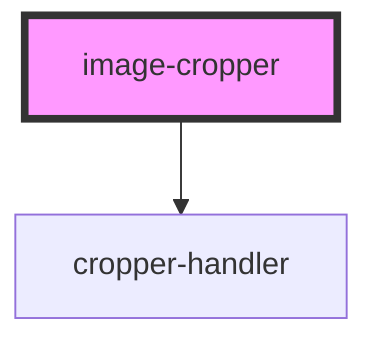

# image-cropper

<!-- Auto Generated Below -->

## Events

| Event          | Description | Type                |
| -------------- | ----------- | ------------------- |
| `mouseRelease` |             | `CustomEvent<void>` |

## Dependencies

### Depends on

- [cropper-handler](cropper-handler)

### Graph

----------------------------------------------

*Built with [StencilJS](https://stenciljs.com/)*
