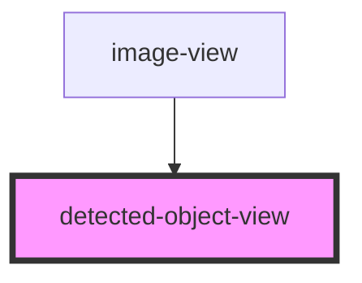

# detected-object-view

<!-- Auto Generated Below -->

## Properties

| Property         | Attribute | Description | Type                                                                  | Default     |
| ---------------- | --------- | ----------- | --------------------------------------------------------------------- | ----------- |
| `detectedObject` | --        |             | `Valueable<DetectedObject> & Partial<MemberObject> & Partial<Linked>` | `undefined` |
| `referenceImage` | --        |             | `HTMLImageElement`                                                    | `undefined` |

## Events

| Event                    | Description | Type               |
| ------------------------ | ----------- | ------------------ |
| `detectedObjectSelected` |             | `CustomEvent<any>` |

## Dependencies

### Used by

 - [image-view](..)

### Graph

----------------------------------------------

*Built with [StencilJS](https://stenciljs.com/)*
