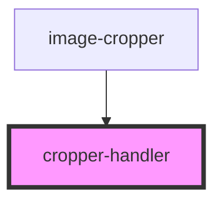

# cropper-handler

<!-- Auto Generated Below -->

## Properties

| Property   | Attribute  | Description | Type      | Default     |
| ---------- | ---------- | ----------- | --------- | ----------- |
| `bounds`   | --         |             | `DOMRect` | `undefined` |
| `disabled` | `disabled` |             | `boolean` | `false`     |
| `handler`  | --         |             | `Handler` | `undefined` |

## Events

| Event                   | Description | Type                   |
| ----------------------- | ----------- | ---------------------- |
| `handlerMoved`          |             | `CustomEvent<Handler>` |
| `handlerReleased`       |             | `CustomEvent<void>`    |
| `searchAreaChangeStart` |             | `CustomEvent<boolean>` |

## Dependencies

### Used by

 - [image-cropper](..)

### Graph

----------------------------------------------

*Built with [StencilJS](https://stenciljs.com/)*
