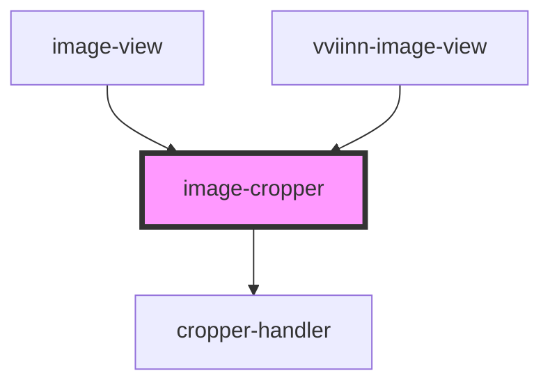

# image-cropper

<!-- Auto Generated Below -->

## Properties

| Property   | Attribute  | Description | Type      | Default |
| ---------- | ---------- | ----------- | --------- | ------- |
| `disabled` | `disabled` |             | `boolean` | `false` |

## Events

| Event                   | Description | Type                         |
| ----------------------- | ----------- | ---------------------------- |
| `cropperMoved`          |             | `CustomEvent<Point & Sized>` |
| `mouseRelease`          |             | `CustomEvent<void>`          |
| `searchAreaChangeStart` |             | `CustomEvent<boolean>`       |

## Dependencies

### Used by

 - [image-view](..)
 - [vviinn-image-view](../../../vviinn-image-view)

### Depends on

- [cropper-handler](cropper-handler)

### Graph

----------------------------------------------

*Built with [StencilJS](https://stenciljs.com/)*
