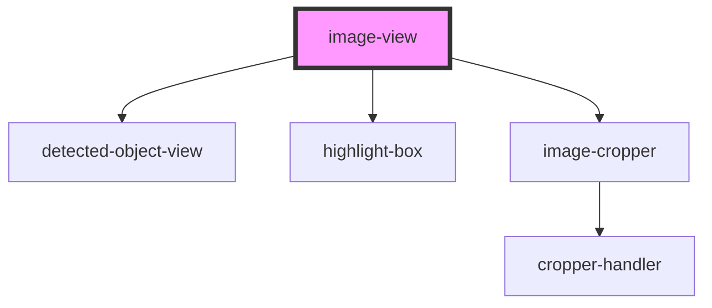

# image-view

<!-- Auto Generated Below -->

## Properties

| Property  | Attribute | Description | Type      | Default |
| --------- | --------- | ----------- | --------- | ------- |
| `loading` | `loading` |             | `boolean` | `false` |

## Events

| Event                    | Description | Type                         |
| ------------------------ | ----------- | ---------------------------- |
| `cropAreaChanged`        |             | `CustomEvent<Point & Sized>` |
| `detectedObjectSelected` |             | `CustomEvent<Point & Sized>` |
| `imageContainerResized`  |             | `CustomEvent<void>`          |

## Dependencies

### Depends on

- [detected-object-view](detected-object)
- [highlight-box](highlight-box)
- [image-cropper](image-cropper)

### Graph

----------------------------------------------

*Built with [StencilJS](https://stenciljs.com/)*
