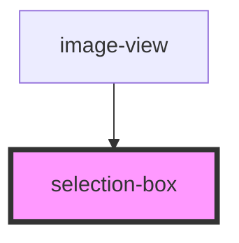

# selection-box

<!-- Auto Generated Below -->

## Properties

| Property    | Attribute | Description | Type        | Default     |
| ----------- | --------- | ----------- | ----------- | ----------- |
| `selection` | --        |             | `Rectangle` | `undefined` |

## Events

| Event              | Description | Type                     |
| ------------------ | ----------- | ------------------------ |
| `selectionClicked` |             | `CustomEvent<Rectangle>` |

## Dependencies

### Used by

 - [image-view](..)

### Graph

----------------------------------------------

*Built with [StencilJS](https://stenciljs.com/)*
