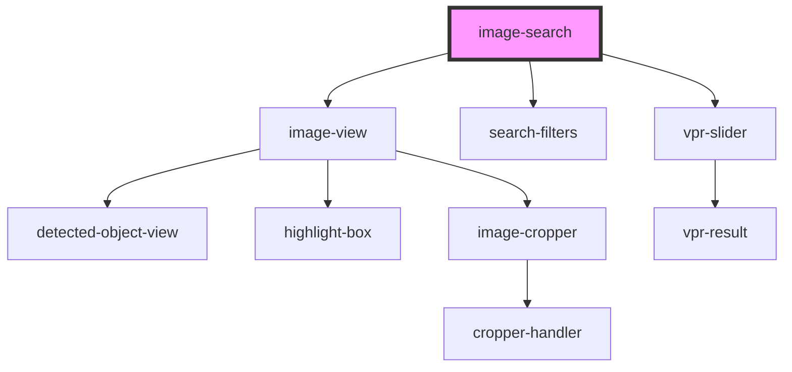

# image-search

<!-- Auto Generated Below -->

## Properties

| Property       | Attribute       | Description                          | Type     | Default     |
| -------------- | --------------- | ------------------------------------ | -------- | ----------- |
| `apiPath`      | `api-path`      |                                      | `string` | `undefined` |
| `currencySign` | `currency-sign` | Currency sign will shown after price | `string` | `undefined` |
| `token`        | `token`         | Mediaopt customer token              | `string` | `undefined` |

## Events

| Event             | Description | Type                                         |
| ----------------- | ----------- | -------------------------------------------- |
| `filtersCleared`  |             | `CustomEvent<void>`                          |
| `objectsDetected` |             | `CustomEvent<ValueObject<DetectedObject>[]>` |
| `resetSearchArea` |             | `CustomEvent<void>`                          |

## Shadow Parts

| Part               | Description |
| ------------------ | ----------- |
| `"button"`         |             |
| `"controls"`       |             |
| `"filters"`        |             |
| `"image-selector"` |             |
| `"results"`        |             |

## Dependencies

### Depends on

- [image-view](image-view)
- [search-filters](search-filters)
- [vpr-slider](../vpr-slider)

### Graph

----------------------------------------------

*Built with [StencilJS](https://stenciljs.com/)*
