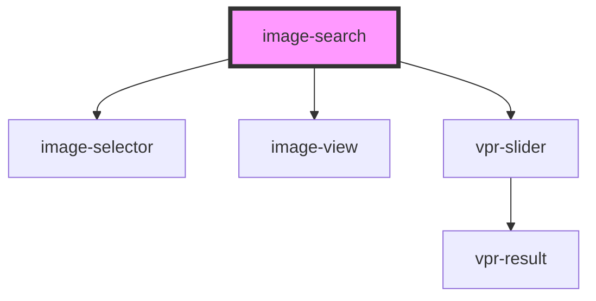

# image-search

<!-- Auto Generated Below -->

## Properties

| Property | Attribute | Description             | Type     | Default     |
| -------- | --------- | ----------------------- | -------- | ----------- |
| `token`  | `token`   | Mediaopt customer token | `string` | `undefined` |

## Shadow Parts

| Part     | Description |
| -------- | ----------- |
| `"grid"` |             |

## Dependencies

### Depends on

- [image-selector](../image-selector)
- [image-view](image-view)
- [vpr-slider](../vpr-slider)

### Graph

----------------------------------------------

*Built with [StencilJS](https://stenciljs.com/)*
