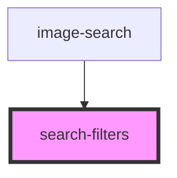

# search-filters

<!-- Auto Generated Below -->

## Properties

| Property | Attribute | Description | Type                  | Default |
| -------- | --------- | ----------- | --------------------- | ------- |
| `filter` | --        |             | `SearchSessionFilter` | `null`  |

## Events

| Event                 | Description | Type                   |
| --------------------- | ----------- | ---------------------- |
| `filterSelectedEvent` |             | `CustomEvent<IonLink>` |

## Dependencies

### Used by

 - [image-search](..)

### Graph

----------------------------------------------

*Built with [StencilJS](https://stenciljs.com/)*
