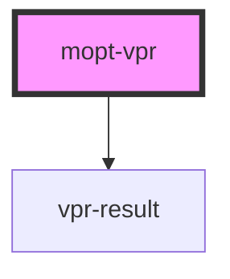

# mopt-vpr

<!-- Auto Generated Below -->

## Properties

| Property     | Attribute     | Description | Type     | Default                  |
| ------------ | ------------- | ----------- | -------- | ------------------------ |
| `blockTitle` | `block-title` |             | `string` | `'Recommended products'` |
| `columns`    | `columns`     |             | `number` | `4`                      |
| `imageRatio` | `image-ratio` |             | `number` | `1.5`                    |
| `imageWidth` | `image-width` |             | `number` | `150`                    |
| `productId`  | `product-id`  |             | `string` | `undefined`              |
| `token`      | `token`       |             | `string` | `undefined`              |

## Dependencies

### Depends on

- [vpr-result](vpr-result)

### Graph

----------------------------------------------

*Built with [StencilJS](https://stenciljs.com/)*
