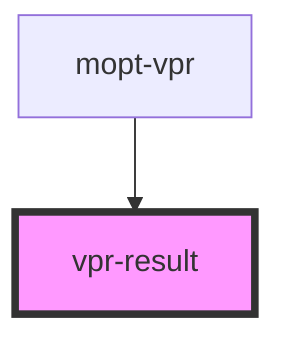

# vpr-result

<!-- Auto Generated Below -->

## Properties

| Property     | Attribute     | Description | Type             | Default     |
| ------------ | ------------- | ----------- | ---------------- | ----------- |
| `imageRatio` | `image-ratio` |             | `number`         | `undefined` |
| `imageWidth` | `image-width` |             | `number`         | `undefined` |
| `item`       | --            |             | `Recommendation` | `undefined` |

## Dependencies

### Used by

 - [mopt-vpr](..)

### Graph

----------------------------------------------

*Built with [StencilJS](https://stenciljs.com/)*
