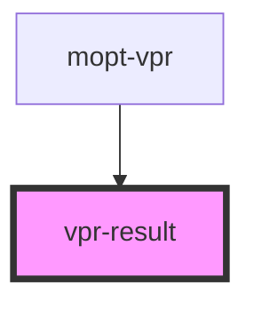

# vpr-result

<!-- Auto Generated Below -->

## Properties

| Property     | Attribute     | Description | Type                                                                                                                                                                                                  | Default     |
| ------------ | ------------- | ----------- | ----------------------------------------------------------------------------------------------------------------------------------------------------------------------------------------------------- | ----------- |
| `imageRatio` | `image-ratio` |             | `number`                                                                                                                                                                                              | `1.5`       |
| `imageWidth` | `image-width` |             | `number`                                                                                                                                                                                              | `100`       |
| `item`       | --            |             | `{ productId?: string; title?: string; brand?: string; productType?: string; deeplink?: string; image?: { original?: string; thumbnail?: string; }; price?: { actual?: number; retail?: number; }; }` | `undefined` |

## Dependencies

### Used by

 - [mopt-vpr](..)

### Graph

----------------------------------------------

*Built with [StencilJS](https://stenciljs.com/)*
