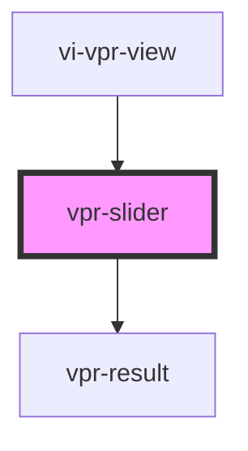

# vpr-slider

<!-- Auto Generated Below -->

## Properties

| Property         | Attribute          | Description | Type                           | Default     |
| ---------------- | ------------------ | ----------- | ------------------------------ | ----------- |
| `imageRatio`     | `image-ratio`      |             | `number`                       | `1.5`       |
| `imageWidth`     | `image-width`      |             | `number`                       | `100`       |
| `mode`           | `mode`             |             | `"auto" \| "grid" \| "manual"` | `undefined` |
| `productsInGrid` | `products-in-grid` |             | `number`                       | `4`         |

## Methods

### `loadProducts(products: Recommendation[]) => Promise<void>`

#### Returns

Type: `Promise<void>`

### `resetSliderPosition() => Promise<void>`

#### Returns

Type: `Promise<void>`

## Dependencies

### Used by

 - [vi-vpr-view](../vpr-view)

### Depends on

- [vpr-result](vpr-result)

### Graph

----------------------------------------------

*Built with [StencilJS](https://stenciljs.com/)*
