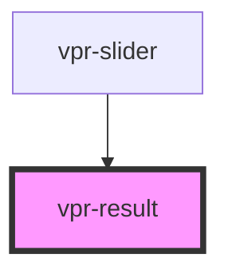

# vpr-result

<!-- Auto Generated Below -->

## Properties

| Property     | Attribute     | Description | Type                                                                                                                                                                                                                  | Default     |
| ------------ | ------------- | ----------- | --------------------------------------------------------------------------------------------------------------------------------------------------------------------------------------------------------------------- | ----------- |
| `imageRatio` | `image-ratio` |             | `number`                                                                                                                                                                                                              | `1.5`       |
| `imageWidth` | `image-width` |             | `number`                                                                                                                                                                                                              | `100`       |
| `item`       | --            |             | `{ groupId?: string; productId?: string; title?: string; deeplink?: string; brand?: string; productType?: string; image?: { original?: string; thumbnail?: string; }; price?: { actual?: number; sale?: number; }; }` | `undefined` |

## Events

| Event                 | Description                                                  | Type                                                                                                                                                                                                                               |
| --------------------- | ------------------------------------------------------------ | ---------------------------------------------------------------------------------------------------------------------------------------------------------------------------------------------------------------------------------- |
| `recommendationClick` | Event fires ones when user click on deeplink                 | `CustomEvent<{ groupId?: string; productId?: string; title?: string; deeplink?: string; brand?: string; productType?: string; image?: { original?: string; thumbnail?: string; }; price?: { actual?: number; sale?: number; }; }>` |
| `recommendationLoad`  | Event fires ones when recommendation rendered on page        | `CustomEvent<{ groupId?: string; productId?: string; title?: string; deeplink?: string; brand?: string; productType?: string; image?: { original?: string; thumbnail?: string; }; price?: { actual?: number; sale?: number; }; }>` |
| `recommendationView`  | Event fires ones when recommendation appears on the viewport | `CustomEvent<{ groupId?: string; productId?: string; title?: string; deeplink?: string; brand?: string; productType?: string; image?: { original?: string; thumbnail?: string; }; price?: { actual?: number; sale?: number; }; }>` |

## Shadow Parts

| Part        | Description |
| ----------- | ----------- |
| `"product"` |             |

## Dependencies

### Used by

 - [vpr-slider](..)

### Graph

----------------------------------------------

*Built with [StencilJS](https://stenciljs.com/)*
