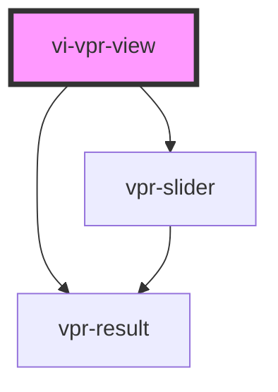

# mopt-vpr

<!-- Auto Generated Below -->

## Properties

| Property       | Attribute       | Description                                | Type      | Default                  |
| -------------- | --------------- | ------------------------------------------ | --------- | ------------------------ |
| `blockTitle`   | `block-title`   | Title for recommendations widget           | `string`  | `"Recommended products"` |
| `columns`      | `columns`       | Number of columns for recommendations      | `number`  | `undefined`              |
| `currencySign` | `currency-sign` | Currency sign will shown after price       | `string`  | `undefined`              |
| `imageRatio`   | `image-ratio`   | Ratio of each recommended product image    | `number`  | `1.5`                    |
| `imageWidth`   | `image-width`   | Width of each recommended product image    | `number`  | `150`                    |
| `pricePrefix`  | `price-prefix`  | prefix will shown before price             | `string`  | `undefined`              |
| `productId`    | `product-id`    | Id of product you need recommendations for | `string`  | `undefined`              |
| `sliderMode`   | `slider-mode`   | Use slider or grid view                    | `boolean` | `false`                  |
| `token`        | `token`         | Mediaopt customer token                    | `string`  | `undefined`              |

## Shadow Parts

| Part                      | Description |
| ------------------------- | ----------- |
| `"grid"`                  |             |
| `"recommendations-title"` |             |
| `"shadow-parts-detect"`   |             |

## Dependencies

### Depends on

- [vpr-slider](vpr-slider)
- [vpr-result](vpr-result)

### Graph

----------------------------------------------

*Built with [StencilJS](https://stenciljs.com/)*
