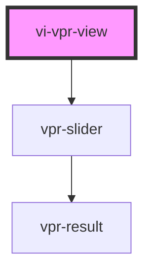

# Visual Product Recommendations

## Using this component

Put a script tag similar to this

```
<script type="module" src="https://cdn.jsdelivr.net/npm/mediaopt-vpr@latest/www/build/mediaopt-widgets.esm.js"></script>
<script nomodule src="https://cdn.jsdelivr.net/npm/mediaopt-vpr@latest/www/build/mediaopt-widgets.js"></script>
```

in the head of your index.html

You can skip script tag with `nomodule` attribute if you do not need to support browsers without JavaScript modules feature.
Then you can use the element anywhere in your template with `<vi-vpr-view></vi-vpr-view>` tag.
Use attributes for provide credentials or customize component view.

### Styling a component

Because some of CSS style properties can not be inherited we provide an styling API based on [CSS Shadow Parts](https://developer.mozilla.org/en-US/docs/Web/CSS/::part) spec.

*NB: If you don't need to support browsers without Shadow Parts support (IE, Firefox for Android and Samsung Internet) you can adding id to style tag and use Shadow Parts styling anywhere*

To use Shadow Parts add *style* tag to head of your page:
```html
<style id="vpr-styles">
    mopt-vpr::part(price-outdated) {
      color: inherit;
      font-size: 12px;
      font-weight: 400;
      text-align: center;
    }

    mopt-vpr::part(price-discount) {
      color: #dc616d;
      font-size: 14px;
      font-weight: 600;
      text-align: center;
    }
</style>
```

Here is a list of shadow parts you can style:

- product
- recommendations-title
- product-image
- product-image-link
- product-title
- price-prefix
- price-currency
- price-regular
- price-outdated
- price-discount
- brand
- product-type

This image describe which elements affected by parts:


Combination of CSS Grids and Shadow Parts allows to change visual position of some elements. For example, if you want to put title below image use

```css
mopt-vpr::part(product-title) {
  grid-row: 1;
}
```

*NB: This feature will not work if you will change display property of element!*

<!-- Auto Generated Below -->


## Properties

| Property       | Attribute       | Description                                | Type             | Default                  |
| -------------- | --------------- | ------------------------------------------ | ---------------- | ------------------------ |
| `apiPath`      | `api-path`      |                                            | `string`         | `undefined`              |
| `blockTitle`   | `block-title`   | Title for recommendations widget           | `string`         | `"Recommended products"` |
| `campaignType` | `campaign-type` | Campaign type                              | `"VPR" \| "VSC"` | `"VPR"`                  |
| `columns`      | `columns`       | Number of columns for recommendations      | `number`         | `undefined`              |
| `currencySign` | `currency-sign` | Currency sign will shown after price       | `string`         | `undefined`              |
| `imageRatio`   | `image-ratio`   | Ratio of each recommended product image    | `number`         | `1`                      |
| `imageWidth`   | `image-width`   | Width of each recommended product image    | `number`         | `150`                    |
| `pricePrefix`  | `price-prefix`  | prefix will shown before price             | `string`         | `undefined`              |
| `productId`    | `product-id`    | Id of product you need recommendations for | `string`         | `undefined`              |
| `sliderMode`   | `slider-mode`   | Use slider or grid view                    | `boolean`        | `false`                  |
| `token`        | `token`         | Mediaopt customer token                    | `string`         | `undefined`              |


## Shadow Parts

| Part                      | Description |
| ------------------------- | ----------- |
| `"grid"`                  |             |
| `"recommendations-title"` |             |
| `"shadow-parts-detect"`   |             |


## Dependencies

### Depends on

- [vpr-slider](../vpr-slider)

### Graph


----------------------------------------------

*Built with [StencilJS](https://stenciljs.com/)*
