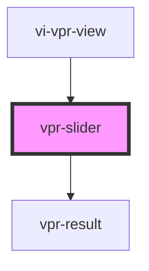

# vpr-slider

<!-- Auto Generated Below -->

## Properties

| Property     | Attribute     | Description | Type               | Default     |
| ------------ | ------------- | ----------- | ------------------ | ----------- |
| `imageRatio` | `image-ratio` |             | `number`           | `1.5`       |
| `imageWidth` | `image-width` |             | `number`           | `150`       |
| `mode`       | `mode`        |             | `"auto" \| "grid"` | `undefined` |

## Methods

### `loadProducts(products: Interfaces["VisualProductSearch"][]) => Promise<void>`

#### Returns

Type: `Promise<void>`

## Dependencies

### Used by

 - [vi-vpr-view](..)

### Depends on

- [vpr-result](../vpr-result)

### Graph

----------------------------------------------

*Built with [StencilJS](https://stenciljs.com/)*
