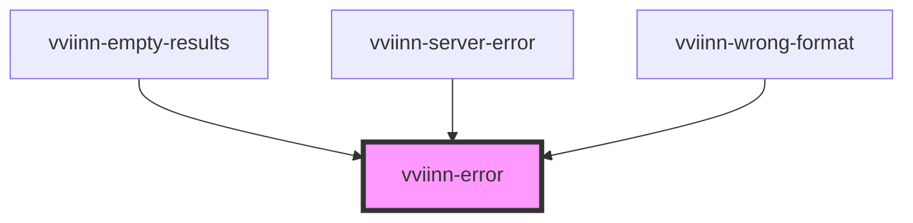

# vviinn-error

<!-- Auto Generated Below -->

## Dependencies

### Used by

 - [vviinn-empty-results](vviinn-empty-results)
 - [vviinn-server-error](vviinn-server-error)
 - [vviinn-wrong-format](vviinn-wrong-format)

### Graph

----------------------------------------------

*Built with [StencilJS](https://stenciljs.com/)*
