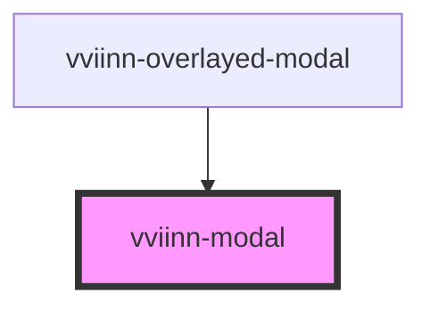

# vviinn-modal

<!-- Auto Generated Below -->

## Properties

| Property | Attribute | Description | Type      | Default |
| -------- | --------- | ----------- | --------- | ------- |
| `active` | `active`  |             | `boolean` | `false` |

## Events

| Event                    | Description | Type                          |
| ------------------------ | ----------- | ----------------------------- |
| `modalClosed`            |             | `CustomEvent<AnimationEvent>` |
| `secondaryActionClicked` |             | `CustomEvent<void>`           |

## Shadow Parts

| Part                 | Description |
| -------------------- | ----------- |
| `"secondary-action"` |             |
| `"title"`            |             |

## Dependencies

### Used by

 - [vviinn-overlayed-modal](../vviinn-overlayed-modal)

### Graph

----------------------------------------------

*Built with [StencilJS](https://stenciljs.com/)*
