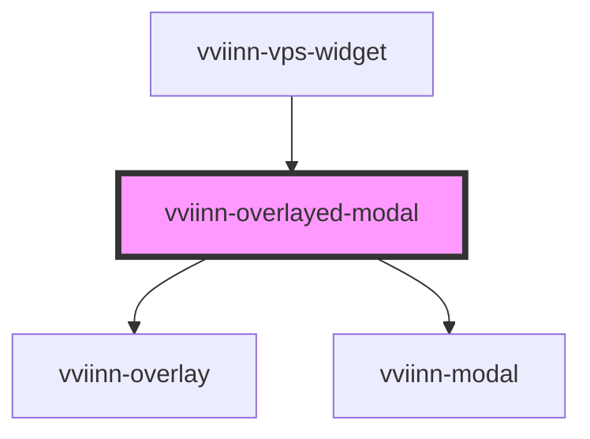

# vviinn-overlayed-modal

<!-- Auto Generated Below -->

## Properties

| Property | Attribute | Description | Type      | Default |
| -------- | --------- | ----------- | --------- | ------- |
| `active` | `active`  |             | `boolean` | `false` |

## Events

| Event                    | Description | Type                |
| ------------------------ | ----------- | ------------------- |
| `modalClosed`            |             | `CustomEvent<void>` |
| `secondaryActionClicked` |             | `CustomEvent<void>` |

## Dependencies

### Used by

 - [vviinn-vps-widget](../vviinn-vps-widget)

### Depends on

- [vviinn-overlay](../vviinn-overlay)
- [vviinn-modal](../vviinn-modal)

### Graph

----------------------------------------------

*Built with [StencilJS](https://stenciljs.com/)*
