# Visual Product Search

## Using this component

Put a script tag similar to this

```
<script type="module" src="https://cdn.jsdelivr.net/npm/mediaopt-vpr@latest/www/build/mediaopt-widgets.esm.js"></script>
<script nomodule src="https://cdn.jsdelivr.net/npm/mediaopt-vpr@latest/www/build/mediaopt-widgets.js"></script>

```
in the head of your index.html

You can skip script tag with `nomodule` attribute if you do not need to support browsers without JavaScript modules feature.
Then you can use the element anywhere in your template with `<vviinn-vps-widget />` tag.

<!-- Auto Generated Below -->


## Properties

| Property       | Attribute       | Description                                      | Type      | Default     |
| -------------- | --------------- | ------------------------------------------------ | --------- | ----------- |
| `active`       | `active`        | When true modal window with widget will be shown | `boolean` | `false`     |
| `currencySign` | `currency-sign` | Currency sign will shown after price             | `string`  | `"€"`       |
| `locale`       | `locale`        | Locale for currency formatting                   | `string`  | `"de-DE"`   |
| `token`        | `token`         | vviinn customer token                            | `string`  | `undefined` |


## Dependencies

### Depends on

- [vviinn-overlayed-modal](../vviinn-overlayed-modal)
- [vviinn-slider](../vviinn-slider)
- [vviinn-slide](../vviinn-slider/vviinn-slide)
- [vviinn-wrong-format](../vviinn-error/vviinn-wrong-format)
- [vviinn-server-error](../vviinn-error/vviinn-server-error)
- [vviinn-teaser](../vviinn-teaser)
- [vviinn-image-selector](../vviinn-image-selector)
- [vviinn-privacy-badge](../vviinn-privacy-badge)
- [vviinn-onboarding](../vviinn-onboarding)
- [vviinn-example-images](../vviinn-example-images)
- [vviinn-image-view](../vviinn-image-view)
- [search-filters](../image-search/search-filters)
- [vviinn-empty-results](../vviinn-error/vviinn-empty-results)
- [vpr-result](../vpr-slider/vpr-result)

### Graph

```mermaid
graph TD;
  vviinn-vps-widget --> vviinn-overlayed-modal
  vviinn-vps-widget --> vviinn-slider
  vviinn-vps-widget --> vviinn-slide
  vviinn-vps-widget --> vviinn-wrong-format
  vviinn-vps-widget --> vviinn-server-error
  vviinn-vps-widget --> vviinn-teaser
  vviinn-vps-widget --> vviinn-image-selector
  vviinn-vps-widget --> vviinn-privacy-badge
  vviinn-vps-widget --> vviinn-onboarding
  vviinn-vps-widget --> vviinn-example-images
  vviinn-vps-widget --> vviinn-image-view
  vviinn-vps-widget --> search-filters
  vviinn-vps-widget --> vviinn-empty-results
  vviinn-vps-widget --> vpr-result
  vviinn-overlayed-modal --> vviinn-overlay
  vviinn-overlayed-modal --> vviinn-modal
  vviinn-wrong-format --> vviinn-error
  vviinn-server-error --> vviinn-error
  vviinn-onboarding --> vviinn-slider
  vviinn-onboarding --> vviinn-slide
  vviinn-example-images --> vviinn-example-image
  vviinn-image-view --> vviinn-detected-object
  vviinn-image-view --> image-cropper
  vviinn-image-view --> highlight-box
  image-cropper --> cropper-handler
  vviinn-empty-results --> vviinn-error
  style vviinn-vps-widget fill:#f9f,stroke:#333,stroke-width:4px
```


----------------------------------------------

*Built with [StencilJS](https://stenciljs.com/)*
